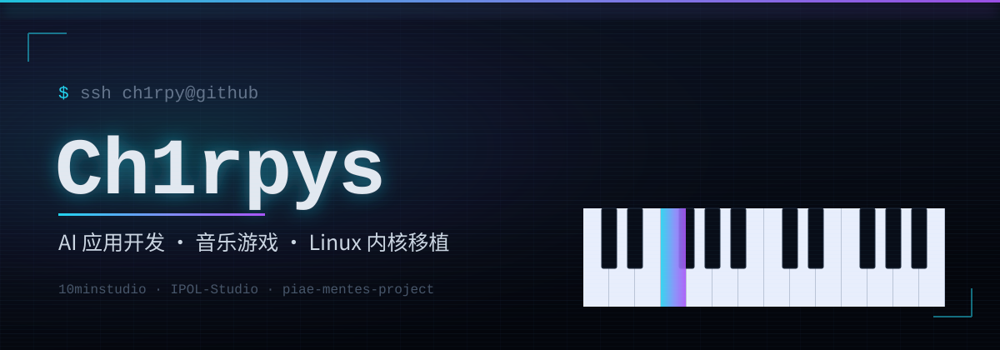

<p align="center">
  
</p>

<p align="center">
  <picture>
    <source media="(prefers-color-scheme: dark)" srcset="https://readme-typing-svg.demolab.com?font=Fira+Code&weight=600&size=26&pause=1500&color=22D3EE&center=true&vCenter=true&width=700&lines=%24%20AI%20%E5%BA%94%E7%94%A8%E5%BC%80%E5%8F%91%E8%80%85%20%2F%20%E9%9F%B3%E4%B9%90%E6%B8%B8%E6%88%8F%E5%88%B6%E4%BD%9C%E8%80%85;%24%20%E9%9F%B3%E6%B8%B8%E3%80%8A%E6%BA%AF%20Resux%E3%80%8B%E6%A0%B8%E5%BF%83%E5%BC%80%E5%8F%91%20%C2%B7%2010minstudio;%24%20%E5%BC%80%E6%BA%90%20AI%20%E6%95%B0%E5%AD%97%E5%88%86%E8%BA%AB%20Mirrai%20%E2%80%94%20%E8%AE%A9%20TA%20%E4%B8%80%E7%9B%B4%E9%83%BD%E5%9C%A8;%24%20Linux%20%E5%86%85%E6%A0%B8%E7%A7%BB%E6%A4%8D%20%E2%80%94%20%E5%B0%8F%E7%B1%B3%E5%B9%B3%E6%9D%BF%208%20Pro;%24%20Building%20things%20that%20sing%2C%20and%20kernels%20that%20boot.&repeat=true">
    <source media="(prefers-color-scheme: light)" srcset="https://readme-typing-svg.demolab.com?font=Fira+Code&weight=600&size=26&pause=1500&color=7C3AED&center=true&vCenter=true&width=700&lines=%24%20AI%20%E5%BA%94%E7%94%A8%E5%BC%80%E5%8F%91%E8%80%85%20%2F%20%E9%9F%B3%E4%B9%90%E6%B8%B8%E6%88%8F%E5%88%B6%E4%BD%9C%E8%80%85;%24%20%E9%9F%B3%E6%B8%B8%E3%80%8A%E6%BA%AF%20Resux%E3%80%8B%E6%A0%B8%E5%BF%83%E5%BC%80%E5%8F%91%20%C2%B7%2010minstudio;%24%20%E5%BC%80%E6%BA%90%20AI%20%E6%95%B0%E5%AD%97%E5%88%86%E8%BA%AB%20Mirrai%20%E2%80%94%20%E8%AE%A9%20TA%20%E4%B8%80%E7%9B%B4%E9%83%BD%E5%9C%A8;%24%20Linux%20%E5%86%85%E6%A0%B8%E7%A7%BB%E6%A4%8D%20%E2%80%94%20%E5%B0%8F%E7%B1%B3%E5%B9%B3%E6%9D%BF%208%20Pro;%24%20Building%20things%20that%20sing%2C%20and%20kernels%20that%20boot.&repeat=true">
    
  </picture>
</p>

<p align="center">
  <a href="https://github.com/Ch1rpys?tab=repositories"></a>
  <a href="https://github.com/Ch1rpys?tab=followers"></a>
  <a href="https://ch1rpy.com"></a>
  <a href="mailto:ch1rpy@163.com"></a>
  
</p>

---

## 👋 关于我 · About

- 🤖 **AI 应用开发** — 用 TypeScript / Python 把大模型塞进真正能用的产品里
- 🎮 **音乐游戏** — 10minstudio 音游《溯 Resux》核心开发；参与 CyanStars 中文虚拟歌手同人音游企划
- 🐧 **内核移植** — 为小米平板 8 Pro 移植 Linux：主线内核补丁、驱动适配、Ubuntu 桌面集成

<p align="center">
  
</p>

---

## 🚀 项目 · Projects

```text
❯ mirrai — 开源 AI 数字分身
  上传聊天记录 → 多阶段性格蒸馏 → 7 层结构化人设 + 6 态情感状态机
  12 家 LLM 提供商即插即用 · 数据全部本地存储 · 带一个「毕业机制」
  TypeScript · React · tRPC · Docker · WeChaty
```

**[Mirrai](https://github.com/Ch1rpys/Mirrai)** ★1.2k · [Releases](https://github.com/Ch1rpys/Mirrai/releases) · [Issues](https://github.com/Ch1rpys/Mirrai/issues)

```text
❯ resux / cyanstars — 音乐游戏
  《溯 Resux》本体工程与制谱器（10minstudio）· CyanStars 中文虚拟歌手同人音游企划
  曲谱版本管理 · 剧情编辑器 · Malody 谱面转换 · 本地化工具链
  C# · Unity · Python
```

**[Resux](https://github.com/piae-mentes-project)** · **[CyanStars](https://github.com/IPOL-Studio/CyanStars)** ★52 · **[音游文档](https://ipol-studio.github.io/CyanStars_Docs/)**

```text
❯ linux-sm8750-piano — 内核移植
  小米平板 8 Pro 的 Linux 移植：主线 7.2.y 内核树 + 驱动移植 + Ubuntu 桌面集成
  C · Linux Kernel
```

**[linux-sm8750-piano](https://github.com/Ch1rpys/linux-sm8750-piano)** · **[xiaomipad-8pro-mainline](https://github.com/Ch1rpys/xiaomipad-8pro-mainline)**

```text
❯ pdfcopy — 顺手造轮子
  PDF 划线取词：跨行跨页不丢字、不带页码和 ???；纯离线、不吃 GPU
  Python · tagged-pdf · ToUnicode
```

**[pdfcopy](https://github.com/Ch1rpys/pdfcopy)** ★3 · [在线体验](https://ch1rpy2613--pdfcopy.modal.run)

> 还有一些在做但还没开源的东西 —— AI 运维诊断平台、私有化教育云服务之类。等它们成熟了会陆续放出来。

---

## 📊 数据 · Stats

<table>
<tr>
<td width="52%" valign="top">
  <picture>
    <source media="(prefers-color-scheme: dark)" srcset="https://github-readme-stats-fast.vercel.app/api?username=Ch1rpys&show_icons=true&hide_border=true&theme=tokyonight&rank_icon=github&include_all_commits=true&line_height=28">
    <source media="(prefers-color-scheme: light)" srcset="https://github-readme-stats-fast.vercel.app/api?username=Ch1rpys&show_icons=true&hide_border=true&theme=default&rank_icon=github&include_all_commits=true&line_height=28">
    
  </picture>
  <br><br>
  <picture>
    <source media="(prefers-color-scheme: dark)" srcset="https://streak-stats.demolab.com?user=Ch1rpys&theme=dark&hide_border=true&border_radius=10&date_format=Y-m-d">
    <source media="(prefers-color-scheme: light)" srcset="https://streak-stats.demolab.com?user=Ch1rpys&theme=default&hide_border=true&border_radius=10&date_format=Y-m-d">
    
  </picture>
</td>
<td width="48%" valign="top">
  <picture>
    <source media="(prefers-color-scheme: dark)" srcset="https://github-readme-stats-fast.vercel.app/api/top-langs?username=Ch1rpys&layout=compact&hide_border=true&theme=tokyonight&langs_count=8">
    <source media="(prefers-color-scheme: light)" srcset="https://github-readme-stats-fast.vercel.app/api/top-langs?username=Ch1rpys&layout=compact&hide_border=true&theme=default&langs_count=8">
    
  </picture>
  <br><br>
  <b>组织 · Organizations</b><br>
  <a href="https://github.com/piae-mentes-project">piae-mentes-project</a> — 音游《溯 Resux》<br>
  <a href="https://github.com/IPOL-Studio">IPOL-Studio</a> — CyanStars 企划<br>
  <a href="https://github.com/YunYingWeb">YunYingWeb</a> — 运营中台
</td>
</tr>
</table>

---

## 🐍 贡献 · Contributions

<div align="center">
  <picture>
    <source media="(prefers-color-scheme: dark)" srcset="https://raw.githubusercontent.com/Ch1rpys/Ch1rpys/output/github-contribution-grid-snake-dark.svg">
    <source media="(prefers-color-scheme: light)" srcset="https://raw.githubusercontent.com/Ch1rpys/Ch1rpys/output/github-contribution-grid-snake.svg">
    
  </picture>
</div>

---

## 📬 联系 · Contact

```text
❯ contact
  mail    ch1rpy@163.com
  web     ch1rpy.com
  docs    ipol-studio.github.io/CyanStars_Docs
```

**[邮件](mailto:ch1rpy@163.com)** · **[博客](https://ch1rpy.com)** · **[CyanStars 文档](https://ipol-studio.github.io/CyanStars_Docs/)**

技术讨论、谱面合作、内核移植互助、或者单纯来打个招呼都行。

---

<p align="center">
  
</p>

<p align="center">
  Made with ☕ and 🎹 by <a href="https://github.com/Ch1rpys">Ch1rpys</a>
</p>
